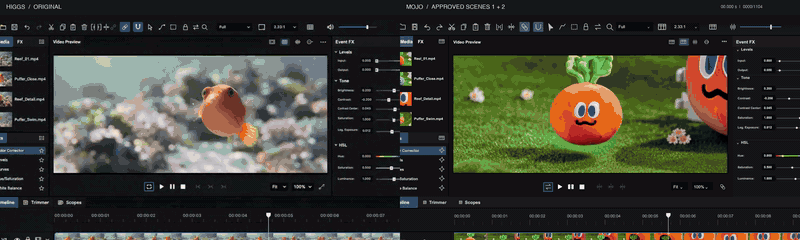
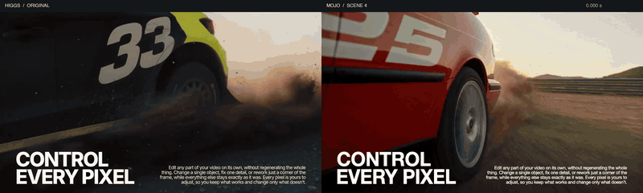
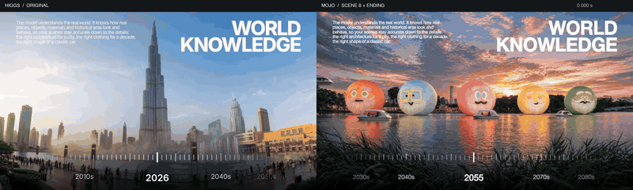

# Higgs Remake Skills

**把这个仓库链接发给 Agent，学习高质量 AI 社媒视频的设计与复刻流程。**

参考 Higgsfield 这类高质量短片，用自己的 AIGC 素材，配合 Agent 的代码能力制作动效、包装、合成与剪辑。本仓库主要公开通用 Skill 与制作方法，可以换模型、换工具、换品牌使用。

**仓库只附三张效果对比 GIF，不提供原始视频、配乐、角色源素材、字体或完整成片工程。**

## 效果展示

以下是本次练习的三个对比 GIF：**左侧是 Higgsfield 原片参考，右侧是使用自己素材制作的复刻结果。**

### 窗口收拢与图层展开



窗口错峰退出、透视与形变、标题交接，以及人物、物体和背景的分层展示。

### 运动中的局部编辑



同一基础视频派生不同贴纸状态，结合局部放大、网格、擦除与合成，完成运动中的数字替换。

### 年代变化与时间标尺



在接近的构图中切换不同年代的场景，配合擦拭与年份标尺，让时间变化可见。

GIF 为压缩、无音频的效果展示，不作为可复用素材包，也不代表安装 Skill 后会自动得到同样结果。**三张 GIF 不属于 MIT 授权范围**，其中参考片与第三方视觉内容的权利归各权利人，见[展示媒体说明](assets/previews/NOTICE.md)。

## 直接把链接发给 Agent

复制当前仓库地址，和下面这段话一起发给你的 Agent：

```text
请读取这个仓库的 README.md、AGENTS.md 和 skills.json。
根据我的任务，读取 social-video-design 和 social-video-rebuild，
以及需要的 references。

我想用自己的素材制作高质量 AI 社媒短片。
先分析我的参考和素材，给出 AIGC 与代码后期分工，
再告诉我需要准备什么，不要直接重做整条视频。
```

Agent 需要能读取仓库文件，不能只看 README 摘要。不能直接访问 GitHub 时，下载 ZIP 到本地，再让 Agent 读取解压目录。

## 安装到自己的 Agent

把仓库链接和下面这段交给支持 Skill 的 Agent：

```text
请从这个仓库安装 social-video-design 和 social-video-rebuild。
先确认我的 Agent 使用哪个技能目录，再复制完整 Skill 文件夹，
包含 SKILL.md、references 和 agents（如有）。
不要只复制 SKILL.md，不要覆盖已有的同名 Skill。
安装后告诉我装到了哪里，以及如何调用。
```

例如，Codex 的个人技能目录通常为 `~/.codex/skills/`。将 `skills/` 下的两个文件夹完整放入该目录；其他 Agent 按其支持的目录和格式安装。客户端可能需要重新打开会话才能发现新技能。

不支持安装 Skill 的 Agent，也可以直接读取这些 Markdown 指令。读取和安装不需要运行本仓库的代码，本仓库没有安装脚本。

## 两个 Skill

| Skill | 适用任务 | 入口 |
|---|---|---|
| `social-video-design` | 学习功能展示、排版、信息密度、节奏与空间动效；策划自己的片子 | [读取 Skill](skills/social-video-design/SKILL.md) |
| `social-video-rebuild` | 拆解参考、规划素材、重建动效、合成返工、审片与交付 | [读取 Skill](skills/social-video-rebuild/SKILL.md) |

调用示例：

```text
请用 $social-video-design，为我的产品规划一段功能展示短片。
```

```text
请用 $social-video-rebuild，分析我的参考视频，先拆解这个镜头。
```

具体调用方式以你的 Agent 为准。

## 值得借鉴的制作方法

- **功能用画面演出来：** 原状态 → 操作 → 变化 → 结果。
- **图形有职责：** 选框解释对象，网格解释编辑范围，标尺解释参数，图层展开解释空间关系。
- **动效有交接：** 进入、稳定、变化、退出各有时机，给观众留阅读和看结果的时间。
- **素材为后期准备：** 要放大就准备清晰元素，要换状态就保持运动一致，要局部调速就考虑干净背景。
- **修改有证据：** 按具体时间点检查布局、透视、阴影、边缘和连续性，保留已经确认的版本。

这些是可迁移的学习方法，不是 Higgsfield 官方品牌规范或已验证的增长公式。

## 工作流

**拆参考 → 规划素材 → 生成 AIGC → 代码动效与合成 → 对比修改 → 确认交付。**

[完整工作流](docs/workflow.md) · [可复制的操作话术](docs/prompts.md)

自然动作、运镜和复杂光照可在生成素材中准备；精确文字、参数、框线与控件由代码制作。实际工具由你和 Agent 选择，工作流没有绑定模型 API 或生成平台。

Skill 提供制作和判断方法，不自带视频生成服务、抠图模型或自动剪辑能力。实际制作仍需要工具、素材和审片，不能保证一键得到参考片同款效果。

我们没有原片内部工程，不据此认定 Higgsfield 使用了 Remotion，也不把模拟演示包装为产品真实能力。

## MIT 开源

本仓库的 Skill、工作流及配套文档采用 [MIT License](LICENSE)，欢迎使用、修改、分享和商用，按条款保留版权与许可说明。

展示 GIF 排除在 MIT 授权之外。外部工具、生成服务和用户自行提供的素材遵守各自许可；MIT 不授予任何原片、配乐、角色、字体或品牌权利。详见[许可范围说明](THIRD_PARTY_NOTICES.md)。

独立学习项目，与 Higgsfield 等相关品牌无官方关系。

如果这些方法帮到了你，欢迎 Star，也欢迎带自己的素材继续创作。
